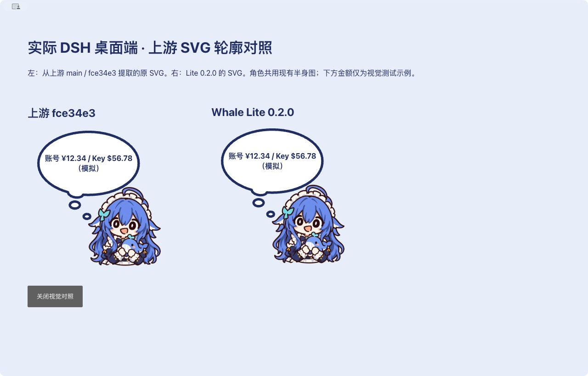
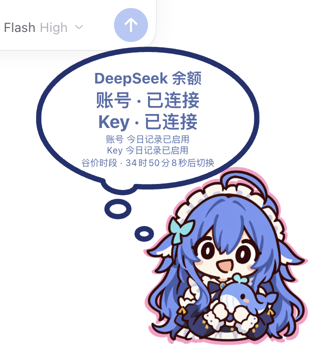

# DeepSeek Whale Lite

官方 DeepSeek Harness（DSH）**桌面端**的 DeepSeek 思考气泡挂件。TypeScript 实现，分别查看登录账号和 API Key 的余额；两者可以属于不同账户。0.3.0 增加可改色角色轮廓，并补齐约定的 DeepSeek 桌面编辑、图表、提醒与素材操作。0.3.1 修复启用挂件后 DSH 窗口无法拖动的问题。实现及验证范围逐项记录，不代表上游所有提供商和平台的功能。



两侧使用相同的新角色，金额为模拟数据。SVG 对照上游 MIT 源码，截图不包含上游未授权媒体。见 [功能对照表](docs/UPSTREAM-PARITY.md)。

## 安装

发布到 npm 后，在官方桌面端打开 **插件 → 添加插件**，输入：

```text
dsh-deepseek-whale-lite
```

也可由 DSH 的插件工具安装：

```json
{"action":"install_bundle","target":"dsh-deepseek-whale-lite"}
```

**0.3.1 当前尚未发布到 npm。** 发布前，在同一入口填写 `dsh-deepseek-whale-lite-0.3.1.tgz` 的本机绝对路径，安装后启用并重启。桌面端管理自己的 `desktop` profile，不使用 CLI 的 `dsh plugin --profile desktop` 命令。重新启用后也请重启，以更新启动时收集的页面注入。

参考：[官方插件管理说明](https://github.com/deepseek-ai/deepseek-harness/tree/master/packages/boot/plugin-manager)。

## 两个账户，分别显示

设置提供 **仅账号登录 / 仅 API Key / 两者同时** 三种显示模式，并保存选择。首次两种来源均已配置时默认同时显示。

- **账号登录**：`deepseek-account`，使用 DSH 账号服务。显示账号名称、充值余额及赠送余额，支持只有赠金的钱包。
- **API Key**：`deepseek-official`，沿用官方模型提供方的 `apiKeyEnv` 凭据引用，默认 `DEEPSEEK_API_KEY`。不要求它属于当前登录账号。
- 常驻气泡按来源显示两行，多币种分别标明。账号名、Key 引用、更新时间和详细状态在“余额与来源详情”中查看。余额和账本不合并；一行失败不影响另一行，失败不显示为零。
- 临时网络失败且宿主仍能确认相同身份时，保留该来源上次余额，标注“缓存／刷新失败”和原更新时间；缓存不形成新观测。登出、Key 变更、失效或无法确认身份时隐藏旧值。
- 显示模式只控制气泡，不修改 DSH 的模型选择，也不停止隐藏来源的统计。退出账号登录不影响已配置的 Key。
- Key 和账号 token 只在宿主处理，页面不接收原始凭据。模型调用仍由官方 DSH 提供方负责；本插件不代理对话、不管理登录或 Key。
- 仅处理官方 `https://api.deepseek.com` 端点。通过同名提供方配置的第三方代理不纳入统计。

参考：[官方两种鉴权路径](https://github.com/deepseek-ai/deepseek-harness/tree/master/packages/llm/llm-deepseek)。

## 气泡、提醒与账本

- **思考气泡**：大泡、两个小圆泡和角色逐级冒出；角色按压 Q 弹、余额滚动。点击角色开始队列，点击气泡推进；可设置点击角色也推进。常驻模式在队列或系统提示结束后回到余额；关闭常驻后末项收起。
- **角色轮廓**：悬停、按压、拖动及键盘焦点时显示原图 alpha 剪影，默认白色、104% 大小。颜色选择器、六位十六进制输入及恢复白色会自动保存；轮廓和角色共用缩放、镜像和按压父层，点击区域不扩大。GIF／APNG 的当前帧同时用于图像、CSS 蒙版和透明度命中，不产生额外图片文件。
- **位置与菜单**：拖动角色，自由摆放或四边吸附，预览可拖动四边线和镜像分界线，像素与百分比两套配置分别保存；位置按最近边缘保存，窗口尺寸或缩放变化后保持边距。贴左自动镜像，文字正向；缩放范围 0.6–2.5 倍，经重启保存；窗口顶部及滚动条避让。悬停按钮或右键打开菜单，按钮可隐藏。
- **气泡编辑**：首次与后续队列增删／拖动排序、整行排序、文本快捷编辑、随机语句逐条样式／复制／排序、加权 A/B、随机语句／图片不连续重复。文本、链接、图片／动图、随机图片、余额／充值／赠金、今日消费、峰谷、对话名、本轮费用、代码动效模块可拖动分行、合并及存入模块库；模块库可拖入气泡或提醒。最多六行、每行六模块，图片独占一行且每气泡最多一张。字体、字号、粗斜体、下划线、颜色、文字与底色渐变可配置；图片显示比例为 10%–100%，峰谷模块独立选择五种样式、峰／谷配色及模板，时段切换原地更新。余额／今日用 `{source}`、`{value}`，对话名用 `{session}`／`{value}`，峰谷另支持 `{状态}`／`{时间}`；预览共用实际渲染器，保存生效、取消还原。
- **提醒**：完成、低余额、今日预算、等待提问、等待授权分别配置内容、开关、音效、音量及关闭时间。独立的“点击角色关闭等待提示”默认关闭；角色音效可单独关闭。提醒及试听的音效组完整播放按下→释放，实际角色随真实按压／释放播放。音效领取由宿主原子保存，避免刷新、重启或多窗口重响；回答、授权取消／结束后解除等待。静音、退出试听和禁用停止相关播放。等待交互优先，其他提醒排队去重；新预算及提问／授权默认关闭。全局关闭气泡仍可使用菜单和通知卡片。
- **账本**：今日、近七天、全部记录、近 30 天柱图、累计与峰值概览、悬停数值及点击日期展开。模型可查看费用估算占比或 token 占比，费用区间保留不确定性，未知费用单列；友好模型名与原始 ID 均可搜索；来源、账户作用域、币种分别筛选，混合来源单轮费用分别列出。低余额、预算和校正绑定具体账本；数值模块可选择账号／Key／当前显示来源。
- **本机素材**：角色与气泡图片导入、预览、自定义素材置顶删除、透明静态裁剪、旋转、双向翻转、滚轮／数值缩放、重置和命名，导入新角色自动选用；GIF／APNG 原字节保留动画。音频波形缩放、平移、双端拖动选段、片段试听及 WAV 保存；音效组支持按住／释放交互试听。内置素材可裁剪为新素材；导入仅保存在本机。默认音效关闭，升级保留已有开关及音量。

角色采用粗线条、平涂的 Q 版半身风格：DeepSeek 微笑／专注／困困、荧、薇斯纳、沃雅妮莎、冰之女皇。DeepSeek 外观依据用户提供的蓝发女仆参考重新生成。图片及音效的来源和许可见 [PROVENANCE.md](PROVENANCE.md)，生成提示词见 [docs/image-prompts.json](docs/image-prompts.json)。

[查看七张角色预览](docs/CHARACTERS.md)。

## 统计口径

**今日观测下降**是插件运行期间相邻余额样本的累计下降，不是账户完整账单，也无法将其他设备调用、赠金到期与模型消费精确区分。充值或赠送造成的余额增加另行显示，提示核对。跨北京时间零点重新建立基线，未观测的区间不补造消费。

**本机估算**只使用 DSH 实际记录的模型 usage。按实际提供方及调用步骤开始时的账号／凭据作用域归属，按 session、turn 和事件序号去重；子会话继承的历史不重复统计。输入、缓存读取、缓存写入、输出分别计量，推理 token 已包含在输出中。

价格核验日期：**2026-10-10**。目前识别 `deepseek-flash`、`deepseek-v4-pro`，及官方说明按 Flash 计费的旧别名 `deepseek-v4-flash`、`deepseek-v4-flash-vision-exp`。费用显示公开峰谷费率的区间，不猜测节假日、最终计费时刻或账号优惠。未知模型保留 token，显示“费用未知”。CNY 与 USD 分别使用官方价格，不做汇率转换。金额内部使用 10⁻⁸ 固定单位；账号钱包的科学计数法及更长小数先用整数解析，再四舍五入到该精度。

参考：[人民币价格](https://api-docs.deepseek.com/zh-cn/quick_start/pricing/) / [美元价格](https://api-docs.deepseek.com/quick_start/pricing/)。

宿主统一下发北京时间峰谷、倒计时和 2026 年节假日日历；未知年份的潜在峰价时段标为未知。DSH 消息时间不等于最终计费时刻，调用费用在记录生成时固定为区间，不随当前时段重算历史。[2026 年节假日安排](https://big5.www.gov.cn/gate/big5/www.gov.cn/zhengce/zhengceku/202511/content_7047091.htm)。

余额校正填写所选日期累计到账与非调用扣减，结果为 **期初余额＋累计到账－非调用扣减－期末余额**。保留原观测、校正记录可撤销；后续下降继续累加。当日提交先独立刷新对应来源，余额版本、账户或币种变化时返回冲突，需重新核对。无余额观测的日期只查看估算。

数据位于 `$DSH_HOME/deepseek-whale-lite/`：`state.json`、`archive/YYYY-MM.json`、`resources/index.json` 和本机资源。独立插件 ID 与接口前缀允许与上游共存，不自动导入上游旧账本、不持久化凭据。状态为 v3；兼容 v1／v2，迁移前分别备份原字节至 `state.json.v1.bak`／`state.json.v2.bak`，保留账本、归档、显示模式、导入角色、方向、位置、音量及气泡配置，重复迁移不改数据。逐轮明细保留 90 天或最多两万条，逐日观测 365 天；先成功归档再移出主文件，全部记录可检索归档。

## 开发与验证

```sh
npm ci
npm run check
npm pack
```

`src/` 为源码；esbuild 生成宿主 `lib/index.js` 和前端 `lib/widget.js`。无运行时 npm 依赖，无安装编译脚本。修改源码后需重新构建，包里携带可直接加载的 JavaScript。

首个验收目标为官方桌面端 **0.2.0-rc.2 / macOS arm64**。窗口拖动修复见 [0.3.1 验证记录](docs/QA-0.3.1.md)，完整功能验证见 [0.3.0 验证记录](docs/QA-0.3.0.md)（[0.2 历史记录](docs/QA.md)）。Web 不在支持范围内；Windows / Linux 未实测；正式 npm 名称安装等待发布后验证。

## 上游与许可

这是 [MeteorNOX/DeepSeek-Balance-Whale-Widget](https://github.com/MeteorNOX/DeepSeek-Balance-Whale-Widget) 的真实 fork。基于 **上游 `main` / `fce34e3abd1fe8b616e287b9864305c7f0be81a0` / 0.3.18**，保留 Git 历史及原作者 MIT 声明。沿用其桌面早期注入和独立余额观测思路，用 TypeScript 重写实现。

0.3.0 以本 fork 的 `1d42598` 为实现基线，修复角色选中底色，并补齐本轮功能范围；沿用上游 MIT SVG 轮廓、描边、配色及动画思路。继续移除其他提供商、代理、订阅额度和 Codex。缺少再分发许可的上游 PNG、GIF、MP3、WAV 及引用已从实现分支与发布包移除，仍可能存在于 fork 历史。拍头和金币效果用代码动画实现。

代码按 [MIT](LICENSE) 分发。角色图片不适用代码的 MIT；原神角色是非官方、非商业同人内容，角色设计权利归原权利人。音效来自 Kenney CC0 素材，不使用游戏提取音频。本项目与 DeepSeek、HoYoverse 无隶属关系。



此截图通过气泡模板隐藏真实金额，只展示来源状态；原始余额、账本和凭据未放入仓库。白色、按压与镜像截图见 [验证记录](docs/QA-0.3.0.md)。
