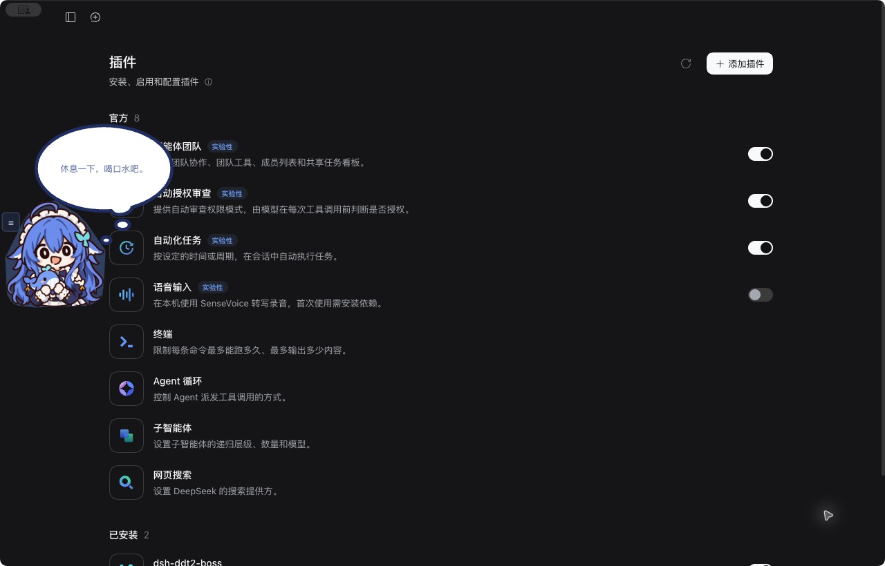

# 0.2.0 上游功能对照

实现基线：本 fork `aa3cd88`；对照上游 `main / fce34e3abd1fe8b616e287b9864305c7f0be81a0`（0.3.18）。范围为约定的 **DeepSeek 官方桌面功能**，排除其他提供商、代理、订阅和 Codex。以下功能均已实现，验证层级分别标明。

| 功能 | 实现 | 验证 |
| --- | --- | --- |
| 大思考泡＋两小泡＋角色 | 原 MIT SVG 路径／椭圆、白底蓝描边、逐级冒出收起、角色比例 59.45% | 实际桌面并排；工具断言 SVG 属性一致 |
| 两种官方来源／三种模式 | 独立来源、作用域、币种；详情页账号名、Key 引用、时间／状态 | 桌面真实不同余额；隔离测试覆盖不同币种、单侧失败、登出及隐藏来源 |
| Q 弹、数值滚动、点击推进 | 角色压缩回弹、金额过渡、气泡推进、可选角色推进、常驻回余额／末项收起 | 桌面操作；自动队列测试 |
| 菜单、关闭气泡 | 悬停／右键、按钮可隐藏；关闭气泡仍有菜单／通知卡片 | 桌面菜单；隔离 UI 关闭气泡后的提问卡片 |
| 四边吸附／自由摆放 | 各边像素／百分比、顶部和滚动条避让、缩放位置保存 | 桌面左侧吸附、0.9 倍及重启；四边参数可编辑 |
| 左侧镜像 | 角色与 SVG 镜像，内容保持正向 | 实际桌面截图 |
| 气泡编辑与加权随机 | 首次／后续队列、增删排序、A/B 权重、随机内容按值排除上次结果 | 自动权重／排除；隔离 UI 保存取消与随机查看 |
| 模块排版／库 | 文本、链接、随机语句／图片、图片／动图、余额／充值／赠金、今日、峰谷、对话名；拖动分行合并／模块库 | 自动六行六模块、图片独占、拆分合并／行内移动；共享预览验收 |
| 样式与草稿 | 字体、字号、粗斜体、下划线、颜色、渐变、底色；保存／取消、同一渲染器 | 隔离 UI 修改、保存及两级取消 |
| 五类提醒 | 完成、低余额、预算、提问、授权；分别配置内容／开关／音效／音量／时间，等待交互优先 | 队列测试与生产宿主事件回放；预算、跨日、去重测试 |
| 双来源适配 | 数值模块来源选择；提醒、校正绑定具体账本；隐藏来源继续统计 | 宿主测试、HTTP 校验 |
| 账本 | 今日／七天／全部、模型占比、日期展开、搜索、来源币种作用域筛选、混合轮次分别费用 | 浏览器 USD／日期展开；自动并发混合来源及 HTTP 筛选 |
| 校正 | 期初＋到账－非调用扣减－期末；保留原观测、撤销、当日独立刷新／冲突 | 自动公式、撤销、后续消费、过期版本与单侧失败；未改真实账本 |
| 峰谷／倒计时 | 宿主北京时间及 2026 日历；未知年份标未知，历史估算区间固定 | 自动节假日、周末、未来未知与切换；桌面倒计时 |
| 图片资源 | 本机导入、预览、自定义素材置顶／删除、透明静态裁剪；GIF／APNG 保留动画 | 桌面裁剪置顶；浏览器文件导入；自动 GIF 字节／删除／路径验证 |
| 音频与组 | 波形选段、试听、WAV 片段、按下／释放组 | 桌面 0.2 秒 WAV 保存试听；浏览器新建组；自动组引用清理 |
| 媒体许可 | 七张现有半身图、四个 CC0 OGG；拍头／金币代码动画 | 包内素材哈希不变，无未授权上游媒体 |
| 状态升级／归档 | v2 前备份、设置账本保留；明细 90 天／两万、逐日 365 天，先归档后裁减，全部可查 | 桌面迁移；自动幂等、损坏保护、上限、归档失败及查询 |
| 启动／禁用 | 早期注入、单挂载、不阻塞宿主、监听计时器和音频清理 | 桌面安装重启；隔离 UI 禁用及接口注销；见 QA 最终结果 |
| npm 名称安装 | 构建产物随包、无安装编译 | 本地 tgz 验收；npm 发布后再验证 |

实际桌面并排图对照提取的上游 SVG 与布局，并未加载上游完整插件。两侧使用同一新角色，金额标明模拟。原生平台与流量边界见 [QA.md](QA.md)。

